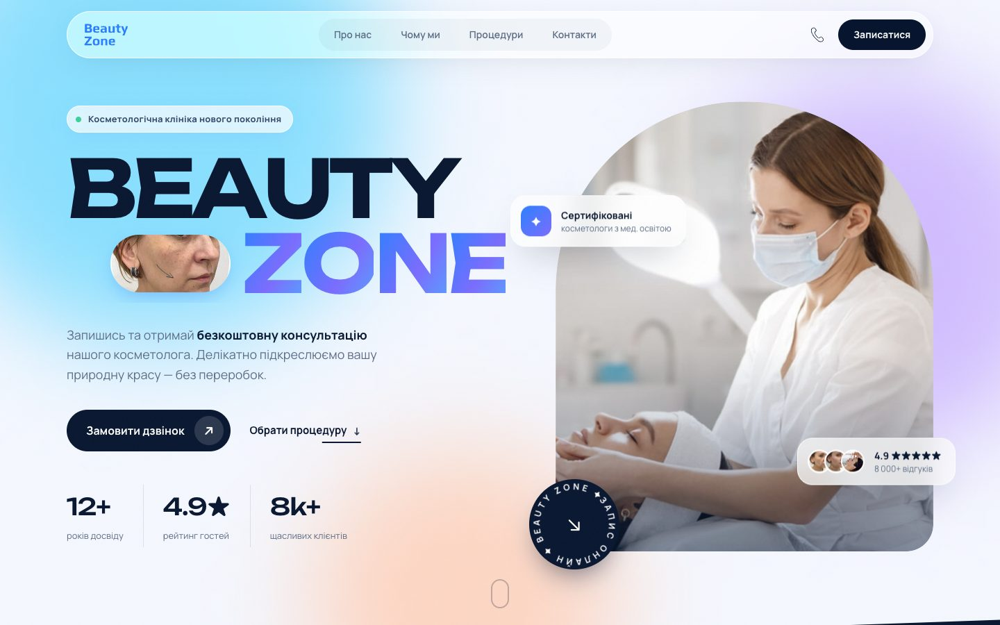
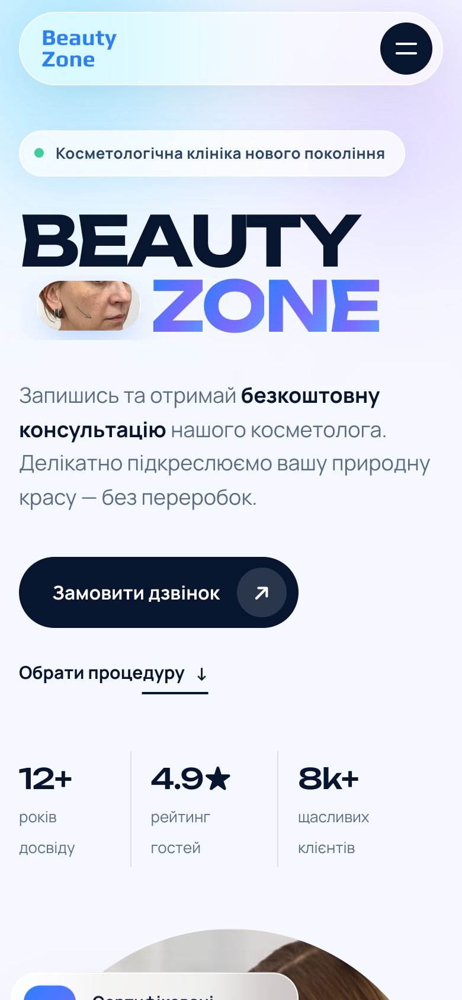

# Beauty Zone — лендінг косметологічної клініки

Адаптивний односторінковий сайт для косметологічної клініки з сучасним дизайном і анімаціями. Написаний на чистому HTML, CSS і JavaScript, без фреймворків і бібліотек.



<p align="center">
  
</p>

## Що реалізовано

- **Hero-блок**: поява заголовка по літерах, градієнтні «плями» на фоні, що повільно рухаються, фото розкривається у формі арки, а скляні картки зміщуються вслід за курсором (паралакс).
- **Анімований лічильник** показників (12+, 4.9, 8k+).
- **Бігучий рядок** з переліком процедур.
- **Блок «Про нас»**: текст підсвічується слово за словом під час прокрутки, фото рухаються з паралаксом.
- **Bento-сітка «Чому ми»** зі світловою плямою, що йде за курсором.
- **Карусель процедур**: 3D-нахил карток, перетягування мишею, scroll-snap, стрілки та смуга прогресу.
- **Форми** з плаваючими підписами, валідацією і сповіщенням про відправку.
- **Модальне вікно** на нативному `<dialog>`: закривається по Esc і кліку по фону.
- **Мобільне меню** на весь екран з круговою анімацією появи.
- **Деталі інтерфейсу**: свій курсор, «магнітні» кнопки, смуга прогресу прокрутки, кнопка «нагору» з кільцем прогресу, навбар ховається під час прокрутки вниз.

## Доступність і сумісність

- Семантична розмітка, `aria`-атрибути, усім можна користуватися з клавіатури.
- Підтримка `prefers-reduced-motion`: якщо в системі вимкнено анімації, сайт показує контент без них.
- Перевірено в Chrome, Firefox і Safari (WebKit), на десктопі та мобільних.
- Fallback-и для старіших браузерів (`100vh` / `100svh`, `overflow-x: hidden` / `clip`, префікси `-webkit-`).

## Стек

- HTML5
- CSS3: custom properties, Grid, Flexbox, `clamp()`, `backdrop-filter`, keyframe-анімації
- JavaScript (ES6+): IntersectionObserver, requestAnimationFrame, Pointer Events
- Шрифти: Unbounded і Manrope (Google Fonts), локальний fallback Play і Roboto

## Структура

```
├── index.html                  # головна сторінка
├── politics_of_confident.html  # політика конфіденційності
├── css/style.css               # стилі
├── js/main.js                  # інтерактивність та анімації
├── images/                     # зображення, SVG-спрайт іконок, favicon
├── fonts/                      # локальні шрифти
└── docs/                       # скриншоти для README
```

## Запуск локально

Відкрийте папку проєкту у VS Code і запустіть **Live Server** (або будь-який інший локальний сервер).

> Якщо відкрити `index.html` подвійним кліком (`file://`), браузер не завантажить іконки з SVG-спрайту. Це обмеження безпеки браузера, на хостингу все працює.
